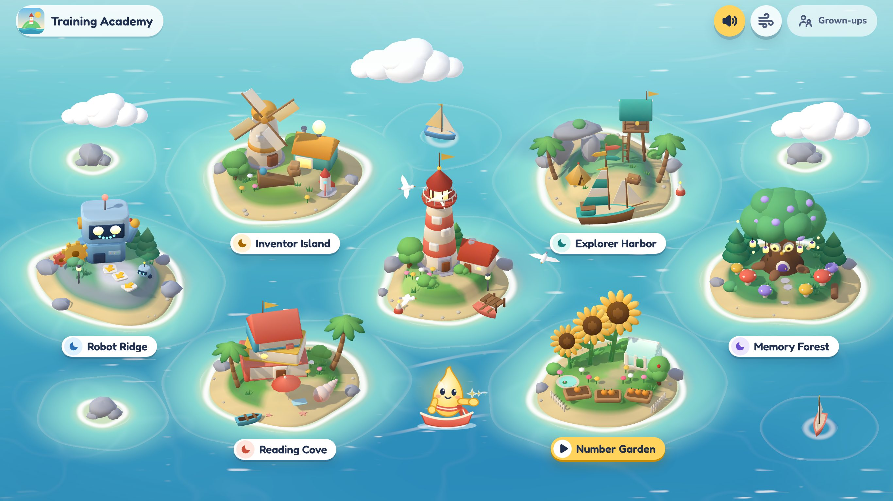

# Training Academy

A browser game that teaches young children (about 3½ to 6) the foundations of reading, number, planning, memory and
making things, through short picture-led activities on a small archipelago. It is a static web app, built to be
hosted on Vercel. There is no account, no server, no advertising and no tracking: everything a child does stays on the device.

## Where it stands

**Phases 01 to 03 of 17 are done: the technical foundation, the look, and the journey into a first whole
activity.** It is built from the plan in [`prompt-series/`](prompt-series/README.md), one phase at a time.

**It has not yet run on a real phone or tablet, and it is not deployed anywhere.** It is written and tested for
iOS and Android as far as emulators go; [`docs/DEPLOYMENT.md`](docs/DEPLOYMENT.md) says how to put it on a phone and
what to check there.



What works today:

- a visit opens on a front door: Glim waves, and the child says who is playing by tapping a picture;
- the home screen is the map: a lighthouse and six modelled islands, each island a button. It is drawn in real-time
  3D where the device can, and as a picture rendered from the same models where it cannot;
- Glim, the guide, who demonstrates, points, wonders, celebrates and waits patiently, and shows it again when
  tapped;
- one whole activity in Number Garden ("which group has the same amount?"): Glim counts and matches first, two
  steps are done together, three alone; a wrong answer is counted and set aside, never marked wrong; help, pause
  and the way home are always there; and what was done unaided is recorded;
- players (a nickname and a picture), saving on the device, and resuming where a child left off;
- a grown-ups area: players, what each has shown, save/load a copy, erase, device settings, diagnostics;
- sound and calm-motion switches, keyboard use, names and announcements for screen readers (not yet tried with
  one), and offline use after the first visit.

What does not exist yet: anything to do on five of the six islands, any spoken instructions, and most of the
curriculum. **Nothing has been deployed**, tried on a physical phone or tablet or on real graphics hardware, or
played by a child. `docs/CONTINUE_HERE.md` says exactly what was and was not verified.

## Run it

You need Node.js 22 (`nvm use` reads `.nvmrc`).

```bash
npm ci
```

```bash
npm run dev
```

Then open <http://localhost:5173>. To run the production build the way it will be served (same headers, same routing,
service worker included):

```bash
npm run build
```

```bash
npm run preview
```

Then open <http://127.0.0.1:4173>.

## Check it

| Command                  | What it does                                                                                       |
| ------------------------ | -------------------------------------------------------------------------------------------------- |
| `npm run typecheck`      | TypeScript, strict                                                                                 |
| `npm run lint`           | ESLint, including the rules that keep the layers apart                                             |
| `npm run format:check`   | Prettier (`npm run format` to fix)                                                                 |
| `npm test`               | Unit tests (Vitest): engine, content, storage, shell, layout, models, assets, Vercel routing       |
| `npm run build`          | Type-check, then the production build into `dist/`                                                 |
| `npm run verify:dist`    | Inspects `dist/`: size budgets, that 3D code is not in the first load, CSP-safe HTML, the manifest |
| `npm run test:e2e`       | Browser tests (Playwright) against the production build, on five screen shapes                     |
| `npm run verify:release` | All of the above, in order                                                                         |
| `npm run screens`        | Captures the review screenshots in `docs/review/` from the running build                           |
| `npm run art:sprites`    | Renders the hub's pictures from the island models (after a build; then build again)                |
| `npm run measure:hub`    | Draw calls, triangles and frame times of the 3D hub at each quality tier                           |
| `npm run measure:idle`   | What each screen costs in CPU while nobody is touching it (Linux only)                             |

The browser tests need Playwright's browsers once:

```bash
npx playwright install chromium webkit
```

With WebKit installed, `npm run test:e2e` also runs the desktop and phone projects in WebKit. To run the smoke tests
against a deployment instead of a local build:

```bash
BASE_URL=https://your-preview.vercel.app npm run test:e2e
```

Continuous integration (`.github/workflows/ci.yml`) runs the checks and the browser tests in Chromium and WebKit on
every pull request.

Two pages exist for looking at the art and are linked from nowhere: `/studio/<island>` (for example
`/studio/number-garden`) shows one island close up, and `/studio/guide` is the guide's character sheet.

## How it is put together

```
src/engine    the learning engine: pure TypeScript, no browser, no clock, no randomness of its own
src/content   the curriculum, as versioned JSON, with correctness checks
src/storage   saving on the device: IndexedDB, then localStorage, then memory; migrations; export and import
src/game      worlds, the lesson runner, the lesson and world screens
src/render    the map: where everything goes, the hub as a picture, and the 3D harbour (three.js, loaded when used)
src/assets    the hub's pictures, rendered from the island models
src/ui        buttons, icons, drawings, and the guide
src/audio     sound that waits for the first touch and respects mute
src/parent    the grown-ups area
src/app       the shell: routes, settings, error handling, diagnostics
tests, e2e    unit tests and browser tests
scripts       build plugins and tools
```

The reasoning behind each choice is in [`docs/ARCHITECTURE.md`](docs/ARCHITECTURE.md).

## Privacy, by construction

- A player is a nickname and a picture. No real name, birth date, e-mail, photo or voice is asked for or stored.
- Nothing is sent anywhere. The site's Content-Security-Policy allows connections to its own origin only, and the
  browser tests fail if any page makes a request to another site.
- No analytics, no advertising, no third-party scripts or fonts. Fonts are bundled.
- A grown-up can save a copy of a player's record as a readable file, load it on another device, or erase everything.
- The grown-ups area opens with a two-second press. That keeps small fingers out by accident; it is not a lock.

This describes the design. It is not a legal review; that is part of Phase 14.

## Documents

| Document                                             | What it holds                                                               |
| ---------------------------------------------------- | --------------------------------------------------------------------------- |
| [`docs/CONTINUE_HERE.md`](docs/CONTINUE_HERE.md)     | The exact tested state, what is unverified, and the next action             |
| [`docs/PROGRESS.md`](docs/PROGRESS.md)               | Phase-by-phase status                                                       |
| [`docs/ARCHITECTURE.md`](docs/ARCHITECTURE.md)       | Structure and decisions                                                     |
| [`docs/CURRICULUM.md`](docs/CURRICULUM.md)           | How content is authored, what is authored, how evidence is reported         |
| [`docs/TEST_RESULTS.md`](docs/TEST_RESULTS.md)       | Commands run and their results                                              |
| [`docs/QUALITY_REPORT.md`](docs/QUALITY_REPORT.md)   | An honest assessment of how it looks and performs, with known shortcomings  |
| [`docs/ART_DIRECTION.md`](docs/ART_DIRECTION.md)     | The visual standard: view, shapes, colour, light, motion, the guide, sound  |
| [`docs/DEPLOYMENT.md`](docs/DEPLOYMENT.md)           | Connecting Vercel, what `vercel.json` does, what a first preview must prove |
| [`docs/ASSETS.md`](docs/ASSETS.md)                   | Every asset, its licence, and how each kind of asset is made                |
| [`docs/review/phase-02/`](docs/review/phase-02/)     | Screenshots of the running build (and `phase-01/`, as it was before)        |
| [`prompt-series/README.md`](prompt-series/README.md) | The seventeen-phase build plan                                              |

## Deployment

Not deployed. `vercel.json` is ready and was tested through a local server that applies the same rules; connecting
the repository to a Vercel project is a step for the owner, described in [`docs/DEPLOYMENT.md`](docs/DEPLOYMENT.md).

## Credits

Fredoka and Nunito are used under the SIL Open Font License. Everything else — drawings, the islands, the guide,
sounds, content — was made for this project. Details are in [`docs/ASSETS.md`](docs/ASSETS.md).

The working practices (a written visual standard, quality tiers, screenshot review, saying plainly what is unverified) follow the example of
[Epoch60](https://github.com/JaredVogler2/Epoch60)'s documentation. No code or artwork was taken from it.
