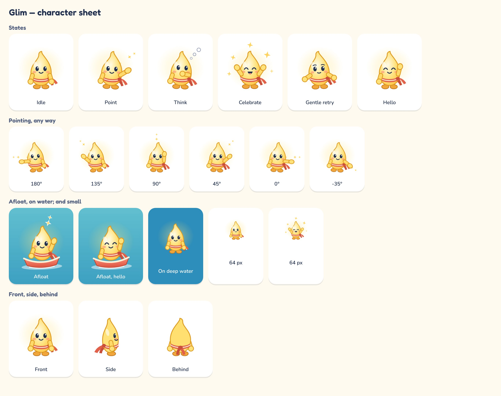

# Art direction

**Status: decided in Phase 02.** This is the standard the game's pictures, motion and sound are made to. Each rule
comes with its reason, so that a later phase can tell a rule that still holds from one that has stopped earning its
keep. How well the current build meets the standard is rated, screen by screen, in `docs/QUALITY_REPORT.md`.

Nothing here was copied. Epoch60's documents were read for method only (a written standard, quality tiers, a
screenshot review with a rubric, plain reporting of what is unverified). No image, model, texture, shader, sound or
line of code came from it or from anywhere else: see `docs/ASSETS.md`.

## The world in one paragraph

A toy archipelago on a sunny table. Seven tiny islands sit in a warm, shallow sea: a striped lighthouse in the
middle and, around it, six places a small child can name from across the room — a house made of books, a garden of
giant sunflowers, a robot that waves, a tree with an owl's face, a windmill, a ship. Everything is chunky, rounded
and painted by hand; the sun is always out; the water never stops moving. A small keeper of the lighthouse's light,
Glim, shows where to go.

**Mood words:** sunny, tactile, tiny, safe, curious.

**What it is like:** a wooden toy set, a pop-up storybook map, a model village, a tide pool at noon.

**What it is not:** realistic terrain, moody or dramatic lighting, a tilt-shift photograph, glossy plastic, neon, a
dashboard. Nothing in it is dark, sharp, tiny or in a hurry.

## The view

| Rule                                                                                                     | Why                                                                                                                                                                            |
| -------------------------------------------------------------------------------------------------------- | ------------------------------------------------------------------------------------------------------------------------------------------------------------------------------ |
| One camera angle, always: 36° below the horizontal, no perspective, never turning.                       | A map stays a map. A child learns where things are once. With no perspective, a place on screen is plain arithmetic, so the 3D scene, its picture and the tap areas all agree. |
| The camera does not sway or drift. Things in the world move; the view does not.                          | Small children track moving things, not a moving frame; and a still view can be drawn once and kept when motion is switched off.                                               |
| Four arrangements — tall phone, upright tablet, squarish window, wide screen — chosen by the shape left. | Islands should be as large as the screen allows. One arrangement scaled to fit would leave a phone with islands the size of a thumbnail.                                       |
| Every island is its own button, and the whole island is the button: land, landmark and name.             | The picture is the instruction. A child taps the thing they want; they never have to find a separate tile that stands for it.                                                  |
| Nothing overlaps: tap areas, names, the guide, boats, rocks and clouds each have their own room.         | A tap must never land on the wrong island, and a name must never be covered. Unit tests hold this for ten screen shapes (`tests/render/archipelago.test.ts`).                  |
| Depth is shown five ways: overlap, haze, paler water far away, shadows falling one way, clouds' shadows. | Without perspective, depth has to be painted in. Far is up the screen, paler and hazier; near is down the screen, deeper and clearer.                                          |

**Layers.** Far: the back row of islands, haze, clouds, the lightest water. Middle: the lighthouse and the islands
beside it. Near: the front row, the guide's boat, the deepest water. On a tall phone the islands become stepping
stones to the lighthouse at the far end.

The arithmetic is in `src/render/archipelago.ts`; nothing in it touches a graphics library.

## Silhouettes

Each island has one landmark, in the middle, that reads as a black shape a hundred pixels wide. If two landmarks
could be confused in silhouette, one of them is wrong.

| Place           | Landmark                                                  | In silhouette                      | What it says about the world                          | What moves                               |
| --------------- | --------------------------------------------------------- | ---------------------------------- | ----------------------------------------------------- | ---------------------------------------- |
| Academy Rock    | A lighthouse in coral and cream bands, a keeper's cottage | A tall banded column with a cap    | Home. The light that guides. (It is the app's icon.)  | Its flag, a star of light, a rowing boat |
| Reading Cove    | A house of three enormous books under an open book        | A stepped block with a peaked roof | Books — and a great shell on the beach, for listening | Flag, bookmark, palms, a boat            |
| Number Garden   | Three sunflowers — small, bigger, biggest                 | Three discs on stems               | Amounts you can see: beds of 1, 2 and 3 pumpkins      | The sunflowers nod                       |
| Robot Ridge     | A workshop shaped like a robot, on a rocky ridge          | A box on a box, with an antenna    | A friendly machine; arrow tiles lead to its door      | It waves; its antenna blinks; cogs turn  |
| Memory Forest   | One great tree with a door and two round windows          | A dome on a trunk                  | A face you remember; toadstools in matching pairs     | Lanterns sway; fireflies circle          |
| Inventor Island | A windmill, a workshop with a light-bulb sign, a rocket   | A cross on a tapered tower         | Things that are built, and tried                      | The sails turn                           |
| Explorer Harbor | A ship with a striped sail, and a lookout on stilts       | Triangles of sail, a hut on legs   | Setting out; looking far                              | The ship rides the swell; pennants fly   |

**Shape rules**

- **Soft and chunky.** Every corner is rounded; nothing is thinner than a child's finger would be at that scale. A
  sharp, thin thing reads as fragile or dangerous, and disappears on a phone.
- **Few and large.** An island has about a dozen things on it, not fifty. One landmark, two or three supporting
  objects, some green, some stones. Fewer finished things beat many unfinished ones.
- **Faces where there is someone.** The robot, the tree and the guide have eyes that look at the child. Buildings
  have a lit window: someone is home.
- **Countable where counting matters.** One, two, three pumpkins; small, bigger, biggest. A picture that teaches does
  not add extras to count by accident.

Every model is measured against the room the layout gives it (`tests/render/islands.test.ts`).

## Colour

### Eight roles

| Role         | Light · mid · deep                | Where it is                                                                                                                 |
| ------------ | --------------------------------- | --------------------------------------------------------------------------------------------------------------------------- |
| **Ink**      | `#8792ac` · `#4d5b7c` · `#22304f` | All words. Eyes. Icons. Never a large area.                                                                                 |
| **Paper**    | `#ffffff` · `#fffaf0` · `#f1dfc0` | Every surface that carries words. Cream walls, sails, sand (`#f6dfa6`).                                                     |
| **Sea**      | `#8ad3da` · `#58c6d2` · `#2e8ebb` | The ground of everything; shallows `#9aead9`. Also Explorer Harbor's teal (`#4fcfc4`).                                      |
| **Sun**      | `#fff6c4` · `#ffd35c` · `#e09a1f` | The one "this way" colour: the open island's name, the main button, Glim, flags, lit windows. Also Inventor Island's amber. |
| **Coral**    | `#ffe6df` · `#ff8f7a` · `#c94f3b` | The lighthouse's bands, Glim's scarf, roofs. Reading Cove.                                                                  |
| **Leaf**     | `#e0f6dd` · `#6fcf74` · `#2f8440` | Everything that grows. Number Garden.                                                                                       |
| **Sky blue** | `#dff0ff` · `#62b4f3` · `#2a6fb5` | Robot Ridge.                                                                                                                |
| **Violet**   | `#ece6ff` · `#a993f8` · `#6b4fd0` | Memory Forest: its blossom, its door, its lanterns' caps.                                                                   |

The six world colours are the ones Phase 01 chose (`src/styles/tokens.css`); each island wears its own in the
things a child looks at first.

### Rules

- **Sun means "this way".** It is used for the thing to do next and for almost nothing else. If everything is
  yellow, nothing is.
- **The sand is the lightest large shape.** A pale ring around every island is what lifts it off the water at a
  glance, in any light and for any kind of colour vision.
- **Saturation follows importance.** Landmarks are the most saturated things on screen, land is quieter, water is
  quieter still, far water is nearly white.
- **Shadows are blue, never grey.** Shade is the colour of the sky it can still see: `#93a2e4`, multiplied. Grey
  shadows make a sunny scene look dirty.
- **Glow is for life.** Only windows, lamps, eyes and Glim give off light.
- **Every shape is a gradient, bottom to top.** A wall is a little darker at its foot; a tree is lighter where the
  sun reaches. One flat colour per shape is what makes built-in-code scenes look built in code.
- **No colour means "wrong".** Nothing turns red at a child.

### Contrast, measured

| Pair                                               | Ratio    | Needed        |
| -------------------------------------------------- | -------- | ------------- |
| Island names: ink on white                         | 13.1 : 1 | 4.5 : 1       |
| The open island's name: ink on sun                 | 9.2 : 1  | 4.5 : 1       |
| Captions: soft ink on white                        | 6.8 : 1  | 4.5 : 1       |
| Focus ring: ink against the palest water           | 7.7 : 1  | 3 : 1         |
| Focus ring: ink against sand                       | 10.0 : 1 | 3 : 1         |
| A white name tag's own edge against the palest sea | 1.7 : 1  | — (see below) |

A name tag is told from the water by its shadow and its dark words, not by its edge; the words are what must be
read, and they are far above the threshold. Colour is never the only signal anywhere: the open island also has a
play mark, a larger tag and the guide pointing at it; the others have a moon.

## Light

| Rule                                                                                                | Why                                                                                                             |
| --------------------------------------------------------------------------------------------------- | --------------------------------------------------------------------------------------------------------------- |
| One sun, high on the viewer's left and a little in front: direction (−0.66, 0.68, 0.32), `#fff1d6`. | The faces turned to the child are the lit ones. Shadows fall to the right and away, where they hide nothing.    |
| The sky fills from above in cool `#dfe9ff`; the ground bounces warm `#ffe3bd`.                      | Warm light and cool shade is what "sunny" looks like. A single white light looks like an office.                |
| Bright, never moody. No tone curve, no exposure tricks: colours arrive as painted.                  | Small children read bright, clear pictures best, and the palette is the palette.                                |
| Contact shade is painted into the ground under everything that stands on it, on every tier.         | It is what stops a house floating. Painted in, it costs nothing and is there even where real shadows are off.   |
| Real shadows where the device can afford them — drawn once and kept, not every frame.               | Nothing that casts a shadow moves, so the shadows need drawing only when the layout or a lifted island changes. |
| A cool rim on edges turned away, and a little haze with distance.                                   | Separates overlapping shapes of the same colour, and pushes far islands back.                                   |

## Materials

Everything solid is painted with **one material** (`src/render/hub3d/paint.ts`): matte, coloured per vertex, with a
small brush texture laid over every surface from three directions so nothing needs unwrapping. The texture — soft
blotches, dry-brush streaks and grain in three channels, 128 pixels square — is generated on the device from a fixed
seed. There are no image textures, no downloaded models, no shine and no physically based anything.

- _Why one material:_ every island is a single draw call, the whole scene a few dozen, and a new island cannot drift
  from the house style because there is nothing else to paint with.
- _Why generated:_ no asset to license, download or cache, and the same on every device.

The **water** is one shader on one flat plane (`Sea.tsx`). Around each island it paints sandy shallows, a line of
foam that breathes against the shore, rings spreading outwards and the island's soft shadow; in open water, slow
marbled light, shoals of glints, short wave marks and the shadows of passing clouds. It is paler far away and deeper
close by. The shoreline is the same formula the land was made from, so the foam follows the land exactly.

## Motion

Movement is how the scene shows it is alive, and how the interface answers. It never demands attention.

| What moves                             | How                                                                  | Roughly              | Why                                                |
| -------------------------------------- | -------------------------------------------------------------------- | -------------------- | -------------------------------------------------- |
| Water: foam, rings, glints, marbling   | Continuous, slow                                                     | Rings pass every 9 s | The scene is never dead, even when nothing happens |
| Leaves, flags, pennants, sunflowers    | Wind: two slow sines out of step                                     | 5–6 s                | Life without anything going anywhere               |
| Landmarks' own parts                   | The mill turns, the robot waves, a light blinks                      | 2–12 s per cycle     | Each island has one thing a child will point at    |
| Boats, clouds, gulls, fireflies        | Small loops and drifts; gulls beat their wings in bursts, then glide | 40–120 s             | Slow parallax: depth                               |
| An island pointed at or focused        | Rises a sixth of a unit and swells 4.5 %                             | 160 ms               | "This is what a tap will choose"                   |
| A name tag pressed                     | Goes down                                                            | 140 ms               | Pressed things look pressed                        |
| Glim                                   | A pose for each state, and a motion around it                        | 0.3–1.2 s to change  | See below                                          |
| The picture giving way to the 3D scene | A cross-fade, in place                                               | 700 ms               | Nothing jumps, because both are in the same places |
| A page arriving                        | A fade and a rise of 8 pixels                                        | 320 ms               | Going somewhere is felt as going somewhere         |
| The front door                         | The card springs in, the pictures pop in one after another           | 0.5 s, 70 ms apart   | "Here you are": an arrival, once per visit         |
| Things being counted                   | Each hops in turn, with its own note                                 | 420 ms apart         | One hop, one note, one thing                       |

- **The frame is still; things in it move.** No camera motion, no parallax scrolling, no screen shake.
- **Two speeds** for the interface: 140 ms for a press, 320 ms for a change of state. A spring only on things that
  are glad.
- **Nothing loops faster than about once a second**, and nothing flashes. (A gull's wing-beat is the one quick
  thing in the scene, and it is small, white on pale water, and stops to glide.)
- **Calm motion** (the switch in the top bar, or the device's own setting) stops all of it. The 3D scene draws one
  still frame; every pose and every state is still there. Motion never carries meaning that stillness loses.
- **The picture moves in steps.** Where the hub is a picture — most often on a device drawing with its processor —
  boats bob and clouds drift a few steps a second. Nobody can tell, and it costs almost nothing
  (`docs/QUALITY_REPORT.md`).

A still picture says nothing about motion. Motion is reviewed in the running game, and where it could not be seen
on real hardware the report says so.

### Showing, inside an activity

What Glim shows is a script (`src/game/lesson/script.ts`): a few beats on a clock, each one thing at a time.

- **One thing moves at a time.** The group is counted; then its match; then both are lit. Never two countings at
  once: the point is that they are the same length.
- **A right answer and a wrong one are shown in the same way.** Both are counted against the group. One ends with
  the two lit together and two notes sounding at once; the other ends with the choice set aside. Neither is a
  reward or a penalty: both are an explanation.
- **A choice that was tried is set aside once, and only after it has been counted.** Until then it stays where it
  is with a dashed edge. Set aside, it is pale and hollow. No cross, no red, no shake.
- **The answer is never lit before the showing reaches it**, even in a demonstration.
- **The way on arrives when the showing is over**, and works before that for anyone who does not want to wait.
- **With calm motion** the board goes straight to where the script ends, and nothing is counted aloud.

## Glim, the guide

Glim is a drop of the lighthouse's own light: the keeper's helper, sent out to show the way. Round, warm, slightly
glowing, in a scarf striped like the lighthouse. Glim does not talk in this phase (voice is Phase 04); everything it
says, it says with its body.

> **The name is provisional.** No check has been made that "Glim" is free to use for a children's product. That is
> the owner's decision; changing it is one string (`src/app/strings.ts`).

**Construction** (`src/ui/Guide.tsx`: one SVG, rigged in parts)

- A teardrop body about as wide as it is tall below the tip, in a sun gradient with an amber edge; a soft glow
  behind, on its own layer.
- A face in the lower two thirds: two tall ink eyes with a highlight, coral cheeks, a small mouth.
- A coral scarf with one cream stripe and a knot on the right, its tail in the wind.
- Two short arms that end in mittens, hung from the shoulders so they can turn all the way round; two feet.
- On the hub Glim sits in a coral rowing boat, the same boat as the one moored at the lighthouse.

**Emotion set**

| State        | Pose                                                       | Motion                           | When                                                     |
| ------------ | ---------------------------------------------------------- | -------------------------------- | -------------------------------------------------------- |
| Idle         | Arms down, small smile                                     | Breathes; blinks every 4–5 s     | Nothing is being asked                                   |
| Point        | One arm reaching towards the thing, body leaning that way  | Sparks of light travel that way  | "Look here": a demonstration, a hint, the open island    |
| Think        | Eyes up, a hand to the chin, three bubbles                 | The bubbles pulse; the glow dims | A new question: wondering along with the child           |
| Celebrate    | Both arms up, eyes closed in a smile, mouth open           | Two hops; sparkles               | A right answer; the end of an activity                   |
| Gentle retry | Head tilted, brows lifted, arms a little out, a soft smile | One small nod                    | After a wrong answer: "not that one — have another look" |
| Hello        | One arm up, eyes smiling                                   | A wave                           | Tapped on the hub                                        |

**Rules for the guide**

- **Never sad, never disappointed, never cross.** A wrong answer gets a tilt of the head and patience. Glim's face
  has no frown to make.
- **Never the only way to know something.** Whatever Glim shows is also in the caption beside it. For assistive
  technology Glim is decoration.
- **Every state is a pose first.** With motion switched off, each state still reads.
- **Points with light.** When Glim points, sparks travel towards the thing. It is the lighthouse's job: showing
  where to look.
- **Sixty-four pixels at the least**, wherever it appears; on the hub it is a button that size or larger.
- **Glim is how a child asks again.** Inside an activity Glim is the "show me again" button, with a small paper
  badge (a speaker and a returning arrow) beside its feet that must never cover it. Asking is free.
- **Glim opens the door.** A visit begins with Glim waving from behind the front door's card, and Glim says hello
  again on the map before pointing the way.

## The two-dimensional language

The interface, the world emblems and the pictures inside activities are flat drawings that belong beside the
painted world without imitating it.

- **Paper on water.** Every control and every surface with words on it is white or cream, round-cornered, with a
  small dark lip under it: a card laid on the sea. Words are never set directly on the picture.
- **Flat shapes, one soft gradient at most.** No outlines, except on characters (Glim's amber edge), where an edge
  keeps a pale figure off a pale ground.
- **Icons**: a 24-unit grid, 2.4-unit strokes, round joins, one colour. Decorative by default; the control carries
  the name.
- **Counting pictures** stay plain single shapes with a soft shadow under each: nothing extra to count.
- **The same eight roles.** A world's page, its emblem and its island share one colour.
- **Round, generous, pressable.** Radii of 12, 20 and 28 pixels and pills for buttons; a pressed thing goes down.
- **A world's emblem is pinned to its island.** On a world's page the picture of the place carries, on a round
  paper badge at its corner, the drawing of what the place is for: one picture, taken in at a glance.
- **A little of the world behind an activity.** Two pale hills in the world's own colour, low on the screen, still.
  Scenery only: an activity's screen is for the activity.
- **Tooltips are for a mouse and a keyboard.** A control that is only a picture has its words in a small ink
  label, on hover after a moment and on keyboard focus at once. A finger gets none.

## Type

Fredoka (rounded, variable) for names, headings and buttons; Nunito (variable) for sentences. Both bundled, Latin
subset. Island names are sized from the islands themselves — 12 to 17 pixels — so they fit under an island a hundred
pixels wide on a small phone held sideways, and are never cut short (a browser test checks). A child is never
required to read: names are for the grown-up alongside and for a screen reader.

## Touch

- An island's tap area is its whole box on screen: at least 96 × 96 pixels on the smallest phone, usually twice
  that.
- Controls a child presses are 56 pixels or more; grown-ups' controls 48. A click map (`npm run screens`) outlines
  and measures every control on a screen in those terms: teal from 56, amber from 48, red below.
- A picture at the front door is 64 pixels or more on the smallest screen; a choice in an activity is far larger.
- A resting finger selects nothing and opens no menu (`docs/ARCHITECTURE.md` → _A resting finger_).
- On a phone held sideways the one thing to do — Play, a choice, "carry on" — is on the first screen.
- The lighthouse is scenery; a tap on it does nothing, and its drawn area never lies inside a tap area.
- One focus ring everywhere: dark, with a white halo, drawn around the whole island.

## Sound motifs

Synthesised on the device (`src/audio/audioEngine.ts`); there are no audio files. Soft, short, quiet, in one key,
so that any two can sound together. Everything works with sound off. Voices and music are Phase 04. A unit test
holds every motif to the same limits: under 0.7 seconds, and never louder than a fifth of full volume.

| Motif    | Notes                                       | Means                                                                                   |
| -------- | ------------------------------------------- | --------------------------------------------------------------------------------------- |
| Tap      | One soft blip                               | "I felt that"                                                                           |
| Hello    | E–G–C, skipping upward                      | Glim's own three notes                                                                  |
| Set sail | A low note and its fifth                    | Choosing the island that is open                                                        |
| Step     | One note                                    | Moving on                                                                               |
| Yes      | C–E–G rising                                | A right answer                                                                          |
| Again    | Two level notes                             | "Have another look." Not a buzzer; it does not fall.                                    |
| On / off | Two notes up / two down                     | A switch                                                                                |
| Ask      | Two notes that end up                       | The question being put, or put again                                                    |
| Counting | One note for each thing, climbing the scale | "One, two, three" without the words. Two groups of the same amount play the same notes. |
| The same | Two notes at once                           | The group and its match, lit together                                                   |
| Done     | C–E–G and the C above                       | The end of an activity                                                                  |

## Quality tiers

The same scene on every tier. What changes is how hard the device works; what never changes is anything a child
needs in order to understand the screen.

| Tier        | Pixel ratio, at most | Shadows              | Decoration | Curves                           | Gulls | For                                                    |
| ----------- | -------------------- | -------------------- | ---------- | -------------------------------- | ----- | ------------------------------------------------------ |
| High        | 2                    | 2048-pixel map       | All        | Fine                             | Three | Laptops and desktops                                   |
| Medium      | 1.5                  | 1024-pixel map       | Most       | Fine                             | Two   | Phones and tablets                                     |
| Low         | 1                    | Painted contact only | Half       | Coarser: a third fewer triangles | None  | Weak devices                                           |
| The picture | —                    | Painted in           | All        | Fine                             | None  | No WebGL, software rendering, "pictures only", failure |

- **Shed resolution before decoration, and decoration before information.** A tier may drop pixels, shadows and
  flowers. It may not drop an island, a name, a landmark or the guide.
- **The picture is not a lesser hub.** It is rendered from the same models, in the same places, with every island
  whole. It is what every visit sees first.
- Left on automatic, the pixel ratio also steps down by itself if frames are slow.

## The review

Every phase that changes how the game looks captures the same screens at the same sizes from the running build
(`npm run screens`) and rates them 1 to 5 in nine categories: composition, craft and materials, cohesive palette,
depth and lighting, liveliness, interface legibility, motion quality, child comprehension, device performance. The
aim is 4 or more in each; anything lower is written down with its cause and its fix. Motion and performance are
never rated from a still picture. The ratings, and the "seen — cause — fix" log, are in `docs/QUALITY_REPORT.md`.

## Rules that outlast this phase

- Nothing child-facing depends on reading, on sound, or on colour alone.
- No "wrong" colour, no shaking, no buzzers, no timers, no disappointed faces.
- Calm motion leaves every screen fully usable.
- Assets are original, or licensed and listed in `docs/ASSETS.md` in the same commit; nothing is fetched from
  another site.
- The first screen appears without the 3D code; the 3D code arrives afterwards and its absence is never an error.
- A new island, character or picture is made with the kit and the palette here, or this document changes first.
